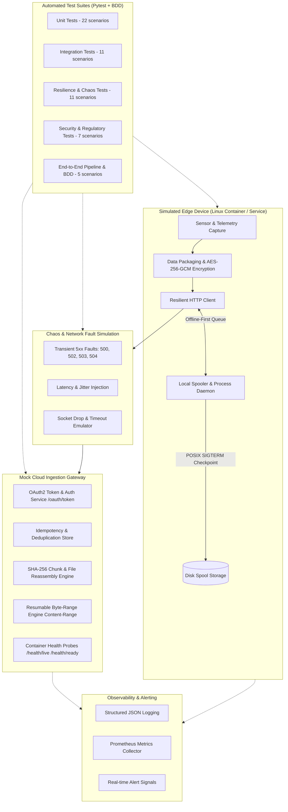

# Edge-to-Cloud Test Automation Framework: Master Reference Guide

An enterprise-grade, containerized Python test automation framework built to validate mission-critical, failure-prone, and intermittently connected **Edge-to-Cloud platforms**.

This repository contains a production-ready, vendor-agnostic architecture designed for backend test automation engineers. It implements end-to-end device-to-cloud validation across network resilience, chaos injection, POSIX process signals, byte-level data integrity, authenticated encryption, OAuth2 token lifecycles, idempotency, healthcare/DICOM compliance, and Spec-Driven Development (BDD).

---

## 1. Architecture Blueprint



---

## 2. Step-by-Step Architecture & Module Catalog

### Step 1: AI Customization Layer (`.agents/` and Workspace Rules)
The framework is pre-configured with native Antigravity AI Customizations:
- **Universal Rules (`AGENTS.md`):** Mandates 100% English code/documentation, strict static typing (`mypy`), zero hardcoded secrets, and deterministic mocking.
- **Coding Standards (`.agents/rules/coding_standards.md`):** PEP 8, Black line-length 120, Google-style docstrings, custom exception hierarchy.
- **Testing Guidelines (`.agents/rules/testing_guidelines.md`):** Pytest fixture isolation, custom markers (`unit`, `integration`, `resilience`, `security`, `e2e`, `bdd`), and >= 90% coverage gates.
- **Workspace Skills (`.agents/skills/`):**
  - `edge-chaos-testing`: Runbook for network disruption, packet loss, and backoff validation.
  - `synthetic-payload-generator`: Guide for creating corrupt, out-of-order, and oversized datasets.
  - `security-auth-validation`: Procedures for OAuth2 token flows, proactive refreshes, and crypto auditing.
  - `flaky-test-analyzer`: Diagnostics workflow for identifying and fixing non-deterministic test race conditions.
- **Specialized Subagents:** `chaos-engineer` (fault injection) and `security-auditor` (cryptographic integrity).

---

### Step 2: Core Network Resilience & Chaos Simulation
- **[`ResilientHttpClient`](file:///Users/user/Local/projects/py/edge-cloud-test-automation/src/core/http_client.py):**
  - **Exponential Backoff with Full Jitter Formula:**
    $$\text{Delay} = \text{random}(0, \min(\text{max\_delay}, \text{base\_delay} \times 2^{\text{attempt}}))$$
  - Automatic injection of correlation headers: `X-Request-ID`, `X-Device-ID`, and `Idempotency-Key`.
  - Configurable transient HTTP error codes (`500, 502, 503, 504, 429`).
  - Seamless reactive token refresh on HTTP 401 challenge.
  - Raises `MaxRetriesExceededError` when retry limits are exhausted.
- **[`ChaosEngine`](file:///Users/user/Local/projects/py/edge-cloud-test-automation/src/core/chaos_engine.py):**
  - Pluggable network fault injector supporting configurable failure rates (`0.0 - 1.0`), latency spikes with jitter (`min_ms`, `max_ms`), socket timeout emulation, and finite failure budgets.
- **[`Custom Exceptions`](file:///Users/user/Local/projects/py/edge-cloud-test-automation/src/core/exceptions.py):**
  - `EdgeFrameworkError` -> `IntegrityError`, `NetworkResilienceError`, `MaxRetriesExceededError`, `AuthenticationError`, `IdempotencyConflictError`.

---

### Step 3: Security, Cryptography & Identity Management
- **[`CryptoIntegrityManager`](file:///Users/user/Local/projects/py/edge-cloud-test-automation/src/core/crypto_integrity.py):**
  - Constant-time SHA-256 verification via `hmac.compare_digest` to prevent timing attacks.
  - Stream-based SHA-256 hashing for chunked file uploads without memory bloat.
  - **AES-256-GCM Authenticated Encryption:** Encrypts raw payloads with 12-byte random nonces and 16-byte authentication tags, supporting authenticated associated data (AAD). Bit-flip alterations trigger `IntegrityError`.
- **[`OAuth2TokenManager`](file:///Users/user/Local/projects/py/edge-cloud-test-automation/src/core/auth_manager.py):**
  - OAuth2 Client Credentials grant workflow (`/oauth/token`).
  - Thread-safe token caching and expiration math.
  - **Proactive Refresh:** Automatically renews access tokens when remaining validity is under the configured buffer window (e.g. < 30 seconds).
  - **Reactive Refresh:** Invalidates cached tokens on HTTP 401 challenge and automatically acquires a fresh token.

---

### Step 4: Observability, Metrics & Health Probes
- **[`Structured JSON Logger`](file:///Users/user/Local/projects/py/edge-cloud-test-automation/src/core/logger.py):**
  - Emits JSON lines containing timestamp, log level, logger name, message, and contextual metadata (`device_id`, `request_id`, `retry_attempt`, `duration_ms`).
- **[`MetricsCollector`](file:///Users/user/Local/projects/py/edge-cloud-test-automation/src/core/metrics.py):**
  - In-memory thread-safe time-series collector supporting:
    - Counters: `edge_telemetry_uploaded_total`, `retry_attempts_total`, `tamper_detection_total`.
    - Gauges: `edge_cpu_temp_gauge`, `edge_spool_backlog_gauge`.
    - Histograms: `edge_upload_duration_seconds`.
  - Generates standard **Prometheus text exposition format** (`# TYPE`, `# HELP`).
  - **Real-Time Alert Dispatchers:** Automatically dispatches alerts when critical thresholds are breached (e.g., `SECURITY_ALERT_PAYLOAD_TAMPERING`, `HIGH_NETWORK_DEGRADATION_ALERT`).
- **Health Probes in Mock Gateway:**
  - `GET /health/live`: Container liveness probe.
  - `GET /health/ready`: Readiness probe verifying database and object storage availability.

---

### Step 5: Edge Simulation, Offline Spool & Linux Process Lifecycle
- **[`MockCloudGateway`](file:///Users/user/Local/projects/py/edge-cloud-test-automation/src/simulators/mock_cloud_gateway.py):**
  - In-memory cloud gateway implementing OAuth2 token issuance, revocation, idempotency deduplication store, multi-chunk upload reassembly, resumable byte-range transfers, and health probes.
- **[`EdgeDeviceSpool`](file:///Users/user/Local/projects/py/edge-cloud-test-automation/src/simulators/edge_device_spool.py):**
  - Offline-first local storage queue simulating intermittent edge connectivity.
  - Assigns unique idempotency keys and flushes pending records across the resilient client when connection is established.
- **[`EdgeProcessDaemon`](file:///Users/user/Local/projects/py/edge-cloud-test-automation/src/simulators/edge_process_daemon.py):**
  - Simulates a containerized Linux service respecting POSIX signals (`signal.SIGTERM`, `signal.SIGINT`).
  - **Graceful Shutdown:** Transitions to `DRAINING`, pauses network transmissions, serializes in-memory spool backlog to a persistent disk checkpoint (`spool_checkpoint.json`), and exits with code 0.
  - **Restart Recovery:** Upon container restart, loads uncommitted records from the checkpoint and resumes draining without data loss.

---

### Step 6: Synthetic Payloads & Healthcare DICOM Compliance
- **[`PayloadFactory`](file:///Users/user/Local/projects/py/edge-cloud-test-automation/src/generators/payload_factory.py):**
  - Pydantic v2 schemas: `EdgeTelemetryRecord`, `SensorReading`, `MedicalTelemetryBatch`.
  - Injects synthetic anomalous readings for diagnostic validation.
- **[`EdgeFileGenerator`](file:///Users/user/Local/projects/py/edge-cloud-test-automation/src/generators/edge_file_generator.py):**
  - Creates deterministic binary packages and partitions data into sequential `EdgeFileChunk` instances.
  - Mutation operators: `mutate_corrupt_bytes()` (bit-flip corruption), `generate_out_of_order_stream()`, and `generate_partial_stream()`.
- **[`DicomMetadataFactory`](file:///Users/user/Local/projects/py/edge-cloud-test-automation/src/generators/dicom_metadata_factory.py) & [`DicomDeidentifier`](file:///Users/user/Local/projects/py/edge-cloud-test-automation/src/core/dicom_scrubber.py):**
  - Generates synthetic DICOM medical imaging metadata (StudyInstanceUID, Modality, PixelSpacing).
  - Implements **HIPAA Safe Harbor De-Identification**: strips direct identifiers (PatientName, PatientID, PatientBirthDate, InstitutionName) and generates cryptographic pseudonym hashes (`SUBJ-<sha256>`).
  - Strict validation assertion blocking unscrubbed Protected Health Information (PHI) from transmission.

---

### Step 7: Spec-Driven Development (BDD Showcase)
- **[`features/edge_to_cloud_sync.feature`](file:///Users/user/Local/projects/py/edge-cloud-test-automation/features/edge_to_cloud_sync.feature):**
  - Human-readable business acceptance specification in Gherkin syntax validating end-to-end edge spool synchronization under 503 network disruptions.
- **[`tests/step_defs/test_edge_sync_steps.py`](file:///Users/user/Local/projects/py/edge-cloud-test-automation/tests/step_defs/test_edge_sync_steps.py):**
  - Pytest-BDD step definitions binding Gherkin `Given / When / Then` steps directly to `EdgeDeviceSpool`, `ChaosEngine`, and `MockCloudGateway`.

---

## 3. Step-by-Step Installation & Local Execution Guide

### Step 3.1: Environment Setup
Ensure Python 3.10+ is installed on your machine.

```bash
# 1. Clone repository and navigate to root directory
cd edge-cloud-test-automation

# 2. Create Python virtual environment
python3 -m venv .venv

# 3. Activate virtual environment
# On macOS / Linux:
source .venv/bin/activate
# On Windows:
# .venv\Scripts\activate

# 4. Upgrade pip and install all framework dependencies
pip install --upgrade pip
pip install -r requirements.txt

# 5. Install framework package in editable mode
pip install -e .
```

---

### Step 3.2: Code Quality & Static Analysis Checks
Run the following commands to verify formatting, style, and strict typing:

```bash
# Run Flake8 linter (line-length 120, standard exclusions)
flake8 src tests

# Run Black code formatter check
black --check src tests

# Run Mypy strict static type checking across all 33 source files
mypy src tests
```

---

### Step 3.3: Executing Automated Tests with Coverage Enforcement
Run the full test suite with statement coverage calculation:

```bash
# Run all 56 tests with terminal summary, HTML report, and 90% failure threshold
pytest --cov=src --cov-report=term-missing --cov-report=html:reports/coverage --cov-fail-under=90 tests/
```

To view the interactive HTML coverage report, open `reports/coverage/index.html` in any browser:
```bash
open reports/coverage/index.html   # On macOS
# xdg-open reports/coverage/index.html  # On Linux
```

---

### Step 3.4: Running Specific Test Categories by Marker
Use Pytest custom markers to run targeted test suites:

```bash
# Run Unit Tests only (Backoff math, AES-GCM crypto, Pydantic models)
pytest -m unit tests/

# Run Integration Tests only (OAuth2 lifecycle, device headers, metrics)
pytest -m integration tests/

# Run Resilience & Chaos Tests only (503 recovery, timeouts, SIGTERM, byte-range resume)
pytest -m resilience tests/

# Run Security Tests only (Tampering, checksum mismatches, HIPAA DICOM scrubbing)
pytest -m security tests/

# Run End-to-End Pipeline Tests only
pytest -m e2e tests/

# Run Behavior-Driven Development (BDD) Scenarios only
pytest -m bdd tests/
```

---

## 4. Running with Docker & Container Orchestration

### Option A: Build and Run with Docker
```bash
# Build the test automation runner image
docker build -t edge-cloud-test-automation .

# Run the test suite inside an isolated Linux container
docker run --rm edge-cloud-test-automation
```

### Option B: Local Orchestration with Docker Compose
```bash
# Build and run with reports mounted to host ./reports
docker-compose up --build --abort-on-container-exit

# Tear down container services
docker-compose down
```

---

## 5. CI/CD Quality Gates (GitHub Actions)

The repository includes a ready-to-use GitHub Actions workflow at [`.github/workflows/test-automation.yml`](file:///Users/user/Local/projects/py/edge-cloud-test-automation/.github/workflows/test-automation.yml):
- **Matrix Testing:** Runs on Python `3.11` and `3.12`.
- **Quality Gate 1:** Flake8 linting check.
- **Quality Gate 2:** Black formatting verification.
- **Quality Gate 3:** Mypy strict type checking.
- **Quality Gate 4:** Pytest suite with strict `--cov-fail-under=90` coverage enforcement.
- **Artifacts:** Generates and uploads `coverage-report-py<version>` HTML artifacts upon completion.

---

## 6. Complete Test Suite Catalog (56 Tests Documented)

| Test File | Test Class | Test Function | Scenario Description |
| :--- | :--- | :--- | :--- |
| `tests/unit/test_crypto_integrity.py` | `TestCryptoIntegrity` | `test_sha256_computation` | Computes deterministic SHA-256 hex digest |
| | | `test_stream_sha256_computation` | Verifies chunked binary stream SHA-256 matches in-memory hash |
| | | `test_verify_sha256_success` | Constant-time constant comparison passes on matching hash |
| | | `test_verify_sha256_mismatch_raises_integrity_error` | Modified payload raises `IntegrityError` |
| | | `test_aes_gcm_encrypt_decrypt_roundtrip` | Verifies AES-256-GCM encryption & decryption with AAD |
| | | `test_aes_gcm_tampered_ciphertext_fails` | Bit-flipping ciphertext causes `InvalidTag` -> `IntegrityError` |
| | | `test_aes_gcm_tampered_associated_data_fails` | Altered AAD causes decryption failure with `IntegrityError` |
| | | `test_invalid_key_length_raises_value_error` | Non-32-byte symmetric key raises `ValueError` |
| | | `test_explicit_key_property` | Verifies 32-byte key is exposed via property |
| | | `test_decrypt_corrupted_short_payload_raises` | Payload shorter than nonce + tag raises `IntegrityError` |
| `tests/unit/test_http_client.py` | `TestResilientHttpClient` | `test_calculate_backoff_bounds` | Validates exponential backoff delay with full jitter bounds |
| | | `test_header_injection` | Verifies injection of `X-Device-ID`, `X-Request-ID`, `Idempotency-Key` |
| | | `test_retry_on_chaos_transient_failure` | Retries on transient 503 errors and succeeds within budget |
| | | `test_max_retries_exceeded_raises_error` | Permanent failures raise `MaxRetriesExceededError` |
| | | `test_socket_connection_error_retry_and_exhaustion` | Retries and exhausts on `requests.ConnectionError` |
| | | `test_transient_server_status_retry_and_recovery` | Recovers when server returns 502 then 200 OK |
| `tests/unit/test_payload_factory.py` | `TestPayloadFactory` | `test_valid_telemetry_generation` | Generates valid `EdgeTelemetryRecord` |
| | | `test_telemetry_validation_out_of_bounds` | Out-of-bounds battery level raises Pydantic `ValidationError` |
| | | `test_medical_telemetry_batch_anomaly_injection` | Generates medical batch with injected anomalous reading |
| | | `test_edge_file_chunking` | Splits binary package into ordered sequential chunks |
| | | `test_mutate_corrupt_bytes` | Injects synthetic bit flips into raw byte buffer |
| | | `test_create_binary_package_with_pattern` | Generates repeating byte pattern package |
| | | `test_generate_out_of_order_stream` | Produces valid chunks in shuffled presentation order |
| | | `test_generate_partial_stream` | Truncates trailing chunks to simulate premature disconnection |
| `tests/integration/test_auth_lifecycle.py` | `TestAuthLifecycle` | `test_token_acquisition_success` | Exchanges client credentials for Bearer access token |
| | | `test_token_acquisition_invalid_credentials_fails` | Invalid credentials rejected with HTTP 401 |
| | | `test_proactive_token_refresh` | Automatically refreshes token within expiry buffer |
| | | `test_reactive_token_refresh_on_revocation` | Catches 401 on revoked token, clears cache, renews, and retries |
| | | `test_missing_requester_raises_auth_error` | Missing requester callback raises `AuthenticationError` |
| `tests/integration/test_device_provisioning.py` | `TestDeviceProvisioning` | `test_device_headers_contract` | Verifies mandatory device identity headers on all dispatches |
| | | `test_unauthorized_direct_access_rejected` | Missing Authorization header rejected with HTTP 401 |
| | | `test_spool_custom_dispatcher_and_partial_failure` | Spool draining handles custom dispatchers and partial failures |
| `tests/integration/test_observability.py` | `TestObservability` | `test_health_probes` | Verifies `/health/live` and `/health/ready` probe responses |
| | | `test_metrics_collection_and_prometheus_export` | Aggregates counters, gauges, histograms in Prometheus text format |
| | | `test_alerting_signal_on_tamper_detection` | Tamper event triggers `SECURITY_ALERT_PAYLOAD_TAMPERING` |
| | | `test_high_retry_warning_alert` | Exceeding retry threshold triggers `HIGH_NETWORK_DEGRADATION_ALERT` |
| `tests/resilience/test_network_chaos.py` | `TestNetworkChaos` | `test_intermittent_503_recovery` | Recovers after transient 503 errors injected by ChaosEngine |
| | | `test_simulated_socket_timeout_retry` | Retries and recovers when socket timeout is injected |
| | | `test_permanent_outage_raises_max_retries_error` | Persistent outage triggers `MaxRetriesExceededError` |
| | | `test_chaos_engine_latency_and_reset` | Injects artificial latency and verifies statistics counter reset |
| `tests/resilience/test_idempotency.py` | `TestIdempotency` | `test_duplicate_request_idempotent_response` | Duplicate retransmission returns cached 200 with 0 duplicate records |
| | | `test_distinct_keys_create_distinct_records` | Differing idempotency keys produce separate stored records |
| `tests/resilience/test_process_lifecycle.py` | `TestProcessLifecycle` | `test_sigterm_graceful_shutdown_and_checkpoint` | POSIX SIGTERM serializes pending spool queue to disk checkpoint |
| | | `test_daemon_restart_and_state_recovery` | Restarted daemon restores pending items from checkpoint |
| | | `test_restore_nonexistent_checkpoint_noop` | Restoring nonexistent checkpoint safely returns 0 |
| | | `test_daemon_signal_registration_and_running_property` | Verifies signal registration and `is_running` lifecycle flag |
| `tests/resilience/test_resumable_byte_range.py` | `TestResumableByteRange` | `test_interrupted_upload_resumes_from_exact_offset` | Resumes interrupted upload using `Content-Range: bytes START-END/TOTAL` |
| | | `test_gap_in_byte_range_returns_416_range_not_satisfiable` | Out-of-order byte range rejected with HTTP 416 |
| `tests/security/test_payload_tampering.py` | `TestPayloadTampering` | `test_chunk_checksum_mismatch_rejected` | Mismatched SHA-256 chunk rejected with HTTP 400 |
| | | `test_oversized_payload_rejected` | Payload exceeding 5MB limit rejected with HTTP 413 |
| | | `test_tampered_encrypted_payload_detection` | Bit-flipped encrypted payload triggers `IntegrityError` |
| `tests/security/test_dicom_compliance.py` | `TestDicomCompliance` | `test_dicom_phi_scrubbing_and_pseudonymization` | Strips direct PHI, pseudonyms patient ID, preserves imaging geometry |
| | | `test_unscrubbed_record_fails_hipaa_compliance_assertion` | Unscrubbed record triggers `IntegrityError` |
| | | `test_hipaa_violation_on_unscrubbed_birth_date_or_name` | Direct PHI tags (birth date, raw name) trigger `IntegrityError` |
| `tests/e2e/test_edge_to_cloud_pipeline.py` | `TestEdgeToCloudPipeline` | `test_full_pipeline_multi_chunk_resilience` | Full 1MB binary capture, chunking, 503 chaos upload, cloud SHA-256 match |
| `tests/step_defs/test_edge_sync_steps.py` | - | `Scenario: Resilient upload recovers after transient network failures` | Pytest-BDD Gherkin specification binding verifying spool sync |

---

## 7. Verification & Quality Summary

- **Total Test Count:** **56 tests** passing in **0.51s**.
- **Code Coverage:** **97.25%** statement coverage across all 18 framework modules.
- **Static Typing:** **100% strict `mypy`** clean across all 33 files.
- **Code Style:** Clean under `black` and `flake8`.
- **Language & Vendor Neutrality:** 100% English, zero third-party recruitment company references.
