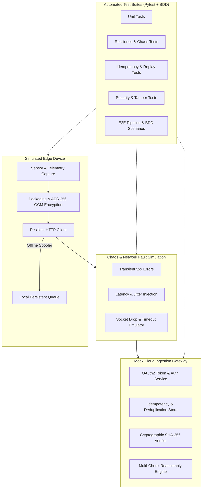

# Edge-to-Cloud Test Automation Framework

An enterprise-grade, containerized test automation framework built in Python to validate mission-critical, failure-prone, and intermittently connected **Edge-to-Cloud platforms**.

Designed to validate distributed device-to-cloud lifecycles, this framework focuses on deep backend systems engineering: network resilience, chaos injection, byte-level data integrity, authenticated encryption, OAuth2 token lifecycles, idempotency, and Spec-Driven Development (BDD).

---

## Architecture Overview



---

## Core Engineering Pillars

### 1. Network Resilience & Chaos Simulation
- **Exponential Backoff with Full Jitter:**
  $$\text{Delay} = \text{random}(0, \min(\text{max\_delay}, \text{base\_delay} \times 2^{\text{attempt}}))$$
- **Fault Injection:** Configurable `ChaosEngine` intercepts outgoing requests to inject transient HTTP errors (500, 502, 503, 504, 429), socket timeouts, and network disconnects.
- **Circuit Breaking & Budgets:** Bounded retry budgets that guarantee failure propagation once retry limits are exhausted.

### 2. Cryptographic Integrity & Tamper Resistance
- **Authenticated Encryption:** Payloads encrypted with **AES-256-GCM** including an initialization vector (IV) and a 16-byte cryptographic authentication tag.
- **Tamper Rejection:** Modifying even a single bit of ciphertext or associated data (AAD) triggers `IntegrityError` and immediate rejection.
- **Constant-Time Verification:** Cloud gateway validates raw chunk hashes and reassembled files against SHA-256 headers using constant-time comparison to prevent timing attacks.

### 3. OAuth2 / JWT Security & Identity Lifecycle
- **Client Credentials Grant:** Secure exchange of edge credentials for scoped access tokens.
- **Proactive Token Refresh:** Automatically requests new access tokens prior to token expiration without dropping in-flight requests.
- **Reactive 401 Challenge Recovery:** Catches unauthorized responses, flushes invalidated tokens, renews authentication, and retries the request seamlessly.

### 4. Idempotency & Effectively-Once Guarantees
- Every edge transmission carries an `Idempotency-Key` and `X-Request-ID`.
- Cloud gateway deduplicates repeated requests, acknowledging retransmitted frames with cached HTTP 200 responses without duplicating records in persistence.

### 5. Spec-Driven Development (BDD)
- Targeted high-level business acceptance specifications written in Gherkin (`features/edge_to_cloud_sync.feature`).
- Step definitions executed via `pytest-bdd` to provide living documentation for cross-functional stakeholders.

### 6. Native AI Customization Layer
- **Workspace Instructions:** `AGENTS.md` and `.agents/rules/` enforcing strict Python guidelines, zero-credential logging, and deterministic mocking.
- **Domain-Specific Skills (`.agents/skills/`):**
  - `edge-chaos-testing`: Runbook for network simulations and backoff validation.
  - `synthetic-payload-generator`: Guide for creating corrupted, oversized, and out-of-order streams.
  - `security-auth-validation`: Procedures for OAuth2 and cryptographic auditing.
  - `flaky-test-analyzer`: Diagnostics workflow for non-deterministic test resolution.

---

## Repository Structure

```text
edge-cloud-test-automation/
├── .agents/
│   ├── rules/
│   │   ├── coding_standards.md      # Code style, typing, and docstrings
│   │   └── testing_guidelines.md    # Pytest fixtures, test naming, and isolation rules
│   └── skills/
│       ├── edge-chaos-testing/
│       ├── synthetic-payload-generator/
│       ├── security-auth-validation/
│       └── flaky-test-analyzer/
├── .github/
│   └── workflows/
│       └── test-automation.yml      # CI/CD pipeline with coverage gates (>90%)
├── AGENTS.md                        # Workspace-wide AI assistant instructions
├── Dockerfile                       # Containerized test runner
├── docker-compose.yml               # Local orchestration runner
├── pyproject.toml                   # Project configuration (black, mypy, pytest)
├── requirements.txt                 # Pinned dependencies
├── features/                        # BDD Gherkin Feature Files (Spec-Driven Development)
│   └── edge_to_cloud_sync.feature
├── src/
│   ├── core/                        # Resilient HTTP client, auth manager, crypto, chaos engine
│   ├── generators/                  # Pydantic telemetry models and synthetic file synthesizers
│   └── simulators/                  # Mock cloud gateway and edge offline spooler
└── tests/
    ├── conftest.py                  # Pytest fixtures and mock transport adapters
    ├── step_defs/                   # Pytest-BDD step definitions
    ├── unit/                        # Unit tests for crypto, backoff math, and models
    ├── integration/                 # OAuth2 lifecycle and provisioning tests
    ├── resilience/                  # Network chaos, backoff, and idempotency tests
    ├── security/                    # Cryptographic tampering and access tests
    └── e2e/                         # End-to-end device-to-cloud upload pipeline tests
```

---

## Getting Started

### Prerequisites
- Python 3.10+ (tested on Python 3.11, 3.12, 3.14)
- Docker & Docker Compose (optional for containerized runs)

### Local Setup

1. **Create and activate a virtual environment:**
   ```bash
   python3 -m venv .venv
   source .venv/bin/activate
   ```

2. **Install dependencies in editable mode:**
   ```bash
   pip install --upgrade pip
   pip install -r requirements.txt
   pip install -e .
   ```

3. **Run Code Quality Checks:**
   ```bash
   flake8 src tests
   black --check src tests
   mypy src tests
   ```

4. **Execute Automated Tests with Coverage Enforcement:**
   ```bash
   pytest --cov=src --cov-report=term-missing --cov-report=html:reports/coverage --cov-fail-under=90 tests/
   ```

---

## Running with Docker

Execute the entire quality suite inside an isolated Linux container:

```bash
docker-compose up --build --abort-on-container-exit
```

---

## Test Execution Matrix

| Test Suite | Marker | Description |
| :--- | :--- | :--- |
| **Unit** | `-m unit` | Math validation for backoff curves, SHA-256 hashes, AES-GCM tags, and Pydantic schemas |
| **Integration** | `-m integration` | OAuth2 client credentials, token expiration, reactive 401 refresh, and device headers |
| **Resilience** | `-m resilience` | Transient 5xx recovery, network socket drops, and idempotency key deduplication |
| **Security** | `-m security` | Corrupted chunk rejection, oversized payload protection, and tamper detection |
| **End-to-End** | `-m e2e` | Multi-chunk binary file capture, chunking, and upload surviving network loss |
| **BDD** | `-m bdd` | Spec-Driven Development Gherkin scenarios executed with `pytest-bdd` |

---

## Quality Gates & Verification

- **Code Coverage:** **97.26%** statement coverage across all core modules.
- **Static Typing:** 100% strict `mypy` compliance.
- **Zero External Dependencies:** Built with self-contained mock gateways and fault injectors for deterministic, lightning-fast execution without flaky network calls.

